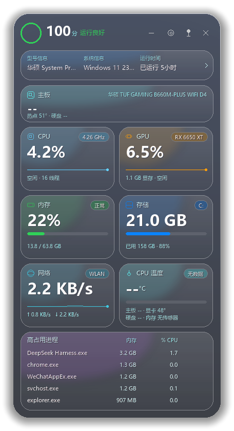
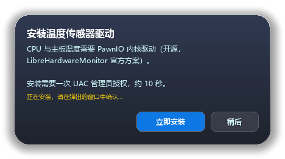
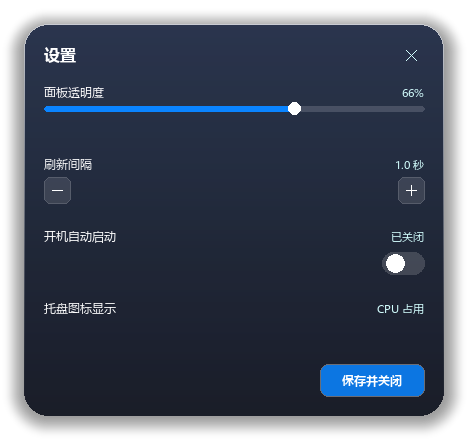

# Liquid Glass 硬件监控

Windows 系统托盘常驻的硬件监控面板，**iOS 26 液态玻璃**风格。

无边框、逐像素透明、真实玻璃质感；CPU / GPU / 内存 / 磁盘 / 网络 / 温度一目了然。

[](https://github.com/fanggafa/hwmon-glass/releases/latest)
[](LICENSE)
[](https://github.com/fanggafa/hwmon-glass)



---

## 目录

- [快速开始](#快速开始)
- [功能](#功能)
- [温度驱动](#温度驱动)
- [权限说明](#权限说明重要)
- [配置](#配置)
- [技术要点](#技术要点)
- [已知限制](#已知限制)
- [开发与贡献](#开发与贡献)
- [文档索引](#文档索引)
- [许可](#许可)

---

## 快速开始

### 方式一：下载即用（推荐）

从 [Releases](https://github.com/fanggafa/hwmon-glass/releases/latest) 下载 **`LiquidGlassMon.exe`**（17.5MB），双击运行即可。

**无需安装 Python，无需 pip，无需手动找驱动。**

首次启动会：

1. 弹出 UAC 管理员授权（用于读取 CPU / 主板温度）
2. 若未安装温度驱动，弹出引导窗口，点「立即安装」自动完成

单文件包含：Python 运行时、全部依赖、传感器库、驱动安装包。

### 方式二：从源码运行

适合开发者。

**环境要求**：Windows 10/11 64 位，Python 3.10

```powershell
git clone https://github.com/fanggafa/hwmon-glass.git
cd hwmon-glass

python setup.py        # 依赖包 + 传感器运行时
python start.pyw       # 或双击 start.pyw
```

### 方式三：自行打包

```powershell
python build_release.py
# 产物：dist/LiquidGlassMon.exe
```

`build_release.py` 会自动下载 LibreHardwareMonitor 运行时与 PawnIO 安装包，
再调用 PyInstaller 打包成单文件。

---

## 功能

### 界面

- **液态玻璃材质** —— 真正的逐像素透明（`UpdateLayeredWindow`），不是假透明。桌面内容实时透过玻璃，而非截图合成
- **多层级半透明** —— 玻璃主体 → 冷色卡片 → 内容，三层叠加，渐变高光 + 镜面边缘 + 柔和投影
- **原生绘制** —— 全部由 Pillow 绘制，无 WebView、无前端构建，单进程运行
- **DPI 自适应** —— 按显示器缩放比例渲染，125% / 150% 下依然清晰

### 监控

| 项目 | 数据来源 | 需要驱动 |
| --- | --- | --- |
| CPU 占用、线程数 | psutil | 否 |
| CPU 频率 | PDH 性能计数器 | 否 |
| CPU 温度 | LibreHardwareMonitor (MSR) | **是** |
| GPU 占用、显存 | PDH 性能计数器 | 否 |
| GPU 温度、热点 | LibreHardwareMonitor | 否 |
| 主板温度 | LibreHardwareMonitor (SuperIO) | **是** |
| 硬盘温度 | LibreHardwareMonitor (NVMe SMART) | 否 |
| 内存占用 | Win32 GlobalMemoryStatusEx | 否 |
| 磁盘空间 | psutil | 否 |
| 网络速率 | PDH 性能计数器 | 否 |
| 高占用进程 | psutil（按 PID 差分） | 否 |

> **关于内存温度**：需要内存条 SPD 芯片支持。多数消费级内存不暴露该传感器，
> 此时卡片显示「内存 无传感器」而非 `--`，明确表达这是硬件限制。

### 交互

- **拖动** —— 按住面板任意空白处可拖到桌面任何位置
- **悬停** —— 按钮高亮 + 文字提示（如「查看硬件详情」）
- **点击** —— 信息条展开硬件详情，右上角四个按钮（最小化 / 设置 / 固定 / 关闭）
- **健康评分** —— 综合负载、温度、磁盘余量计算，超范围才扣分

### 托盘

| 操作 | 效果 |
| --- | --- |
| 左键单击 | 显示/隐藏面板 |
| 右键 | 菜单：显示面板、图标指标切换、硬件详情、设置、退出 |

图标显示可切换的数字指标：CPU/GPU 占用、CPU/GPU/主板温度、内存占用、评分。

> Windows 11 默认把新图标折叠进「^」。把它拖到任务栏即可常驻。

---

## 温度驱动

CPU 与主板温度需要 [PawnIO](https://pawnio.eu/) 内核驱动（开源、可审计，
LibreHardwareMonitor 官方推荐方案）。

### 自动安装（推荐）

程序首次启动会检测驱动，未安装时弹出引导窗口：



点「立即安装」即可，程序会自动：

1. 从内置资源释放 `PawnIO_setup.exe`
2. 以管理员权限运行 `-install -unrestricted -silent`
3. 等待驱动服务就绪

`-unrestricted` 是关键 —— 默认模式会拒绝 MSR 访问，导致 CPU 温度读不到。

### 手动安装

若自动安装失败，可手动执行：

```powershell
# 下载 https://github.com/namazso/PawnIO.Setup/releases/latest
PawnIO_setup.exe -install -unrestricted -silent

# 验证
sc query PawnIO     # STATE 应为 4 RUNNING
```

---

## 权限说明（重要）

CPU 和主板温度来自 **MSR 寄存器**与 **SuperIO 芯片**，属于内核级访问。

| 权限 | 可读数据 |
| --- | --- |
| 普通用户 | 占用率、频率、显存、磁盘、网络、**显卡温度**、**硬盘温度** |
| 管理员 | 以上全部 + **CPU 温度**、**主板温度** |

PawnIO 驱动只向管理员开放设备句柄，普通权限会返回 `0x80070005 拒绝访问`。
因此程序启动时**自动请求一次提权**；若拒绝，仍可正常运行，只是少了 CPU / 主板温度。

---

## 配置

设置窗口点面板齿轮图标或托盘右键菜单打开：



| 项目 | 范围 | 说明 |
| --- | --- | --- |
| 面板透明度 | 40% – 100% | 越低越透 |
| 刷新间隔 | 0.5 – 5.0 秒 | 采样周期 |
| 开机自动启动 | 开 / 关 | 写入 `HKCU\Software\Microsoft\Windows\CurrentVersion\Run` |
| 托盘图标显示 | 8 种指标 | 从托盘右键菜单切换 |

配置保存在程序同目录的 `settings.json`，可手动编辑，删除即恢复默认。

---

## 技术要点

**为什么不用 WMI 读温度？**
`MSAcpi_ThermalZoneTemperature` 在多数台式机上不存在；`\Thermal Zone Information`
计数器虽有数值，但实测**加载 CPU 后纹丝不动**（恒为 301K），是废弃数据。
唯一可靠路径是 LibreHardwareMonitor 直接读 MSR / SuperIO。

**为什么用 pythonnet 而不是纯 Python？**
MSR 与 SuperIO 没有成熟的纯 Python 库。LibreHardwareMonitor 是 .NET 生态里
维护最活跃的传感器库，通过 pythonnet 调用可复用其全部驱动适配层。

**为什么从字节加载 DLL？**
从网络下载的程序集带有「来源标记」，.NET Framework 会拒绝按路径加载
（`0x80131515`）。改用 `Assembly.Load(bytes)` 绕过路径检查。

**为什么玻璃不需要截图？**
分层窗口保留 alpha 通道，桌面内容由 DWM 在玻璃下方实时合成。
早期版本尝试抓屏 → 高斯模糊，但截屏会拍到面板自身，导致背景是「面板的模糊倒影」。

**为什么需要单实例锁？**
程序会提权重启自己。没有互斥锁时，原进程和提权副本同时运行，
结果是两个托盘图标、两个面板，菜单看起来「点了没反应」—— 实际点在了看不见的那个上。

---

## 已知限制

- **内存温度**需要内存条 SPD 传感器支持，多数消费级内存没有
- **显卡温度**依赖厂商驱动，虚拟机 / 远程桌面下可能读不到
- 天气功能尚未实现

---

## 开发与贡献

```powershell
pip install -r requirements.txt pytest ruff
python -m pytest tests -v          # 单元测试
python -m ruff check hwmon tests --select E9,F
```

### 贡献流程

```
feat/xxx ──PR──▶ CI 检查 ──通过──▶ squash 合并到 main
                                    │
                                    └─ 版本号变化时自动发布 Release
```

`main` 受分支保护：**不能直接 push**，必须走 PR，且 `test` / `lint` / `sanity` 三项检查全绿才能合并。

发版不需要手动打 tag —— 只要在 PR 里按规则提升 `hwmon/__init__.py` 的 `__version__`，
合并后 `Release` 工作流会自动构建 exe、算校验值、创建 Release。

⚠️ **文档同步是强制的**：改完代码必须把关键点更新到对应文档，才能提交 PR。
详见 [CONTRIBUTING.md](docs/CONTRIBUTING.md)。

---

## 文档索引

| 文档 | 内容 |
| --- | --- |
| [CONTRIBUTING.md](docs/CONTRIBUTING.md) | 分支模型、提交规范、**文档同步要求**、发版流程 |
| [VERSIONING.md](docs/VERSIONING.md) | 语义化版本**升位判定标准**（何时升 1.0.2 / 1.1.0 / 2.0.0） |
| [CHANGELOG.md](docs/CHANGELOG.md) | 逐版本变更记录 |
| [RELEASE_NOTES.md](docs/RELEASE_NOTES.md) | 当前版本的 Release 页面正文 |

---

## 项目结构

```
├── main.py              命令行入口
├── start.pyw            双击启动（无控制台）
├── setup.py             一键安装依赖
├── fetch_deps.py        下载传感器运行时
├── build_release.py     打包发布版 exe
├── LiquidGlassMon.spec  PyInstaller 配置
├── requirements.txt
├── hwmon/
│   ├── app.py           主循环、窗口管理、事件分发
│   ├── panel.py         面板布局与绘制
│   ├── render.py        玻璃材质、图标、图表等绘制基元
│   ├── sampler.py       数据采集（psutil + PDH + LHM）
│   ├── lhm.py           LibreHardwareMonitor 桥接（pythonnet）
│   ├── hardware.py      硬件清单（WMI / 注册表）
│   ├── driver.py        PawnIO 检测与安装
│   ├── setup_sheet.py   驱动引导窗口
│   ├── settings.py      配置持久化与开机自启
│   ├── settings_sheet.py 设置窗口
│   ├── details.py       硬件详情窗口
│   ├── tray.py          托盘图标与菜单
│   ├── window.py        分层窗口封装（Win32）
│   ├── single.py        单实例锁
│   └── elevate.py       UAC 提权
├── tests/               单元测试
├── assets/              PawnIO 安装包（构建时下载，不入库）
├── lib/                 传感器运行时（构建时下载，不入库）
└── docs/                文档与截图
```

---

## 许可

本项目代码采用 **MIT License**。

依赖的 [LibreHardwareMonitor](https://github.com/LibreHardwareMonitor/LibreHardwareMonitor)
采用 **MPL-2.0**，其二进制由 `fetch_deps.py` 在运行时下载，不随本仓库分发。

[PawnIO](https://github.com/namazso/PawnIO) 为独立开源驱动，需单独安装。
