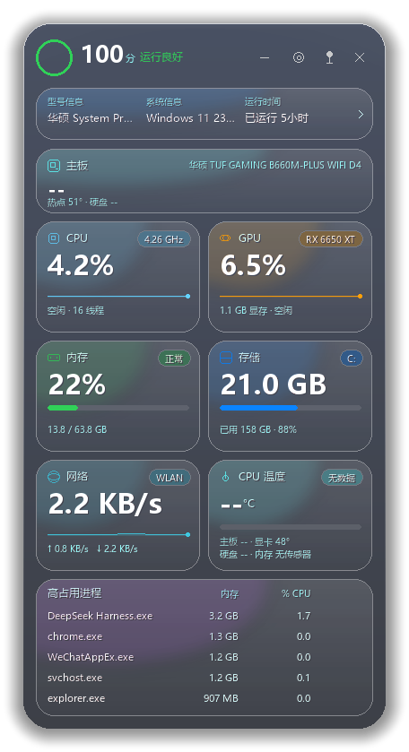

## 液态玻璃硬件监控 v1.0.1

Windows 系统托盘硬件监控面板，iOS 26 液态玻璃风格。**开箱即用，无需安装 Python。**



---

### 本次更新

- **修复**：首次运行引导安装驱动时崩溃（`app.py` 缺少 `os` 导入）
- 新增 CI 流水线与分支保护，后续版本更稳定

---

### 下载

| 文件 | 说明 |
| --- | --- |
| `LiquidGlassMon.exe` | 单文件程序，约 27MB，双击运行 |
| `SHA256SUMS.txt` | 校验值 |

### 使用

1. 下载 `LiquidGlassMon.exe`
2. **双击运行** —— 首次启动会请求管理员授权
3. 若未安装温度驱动，程序会弹出引导窗口，点「立即安装」即可
4. 面板出现在屏幕右下角

> 单文件已包含 Python 运行时、全部依赖、传感器库、驱动安装包。
> 唯一的例外是内核驱动本身 —— Windows 要求它必须经 UAC 提权安装，
> 程序会自动引导你完成这一步。

### 能读到什么

| 项目 | 无需驱动 | 需要 PawnIO 驱动 |
| --- | :---: | :---: |
| CPU 占用 / 频率 / 线程 | ✅ | |
| GPU 占用 / 显存 | ✅ | |
| 显卡温度 / 热点 | ✅ | |
| 硬盘温度 | ✅ | |
| 内存 / 磁盘 / 网络 | ✅ | |
| **CPU 温度** | | ✅ |
| **主板温度** | | ✅ |

驱动由程序内置并一键安装，无需手动下载。

### 已知限制

- **内存温度**需要内存条 SPD 传感器支持，多数消费级内存没有
- **显卡温度**依赖厂商驱动，虚拟机 / 远程桌面下可能读不到
- 托盘图标与天气功能尚未接入

### 校验

```powershell
Get-FileHash LiquidGlassMon.exe -Algorithm SHA256
```

---

**许可**：代码 MIT。内置的 [LibreHardwareMonitor](https://github.com/LibreHardwareMonitor/LibreHardwareMonitor) 为 MPL-2.0，[PawnIO](https://github.com/namazso/PawnIO) 为独立开源驱动。

**完整变更**：见 [CHANGELOG.md](https://github.com/fanggafa/hwmon-glass/blob/main/CHANGELOG.md)
