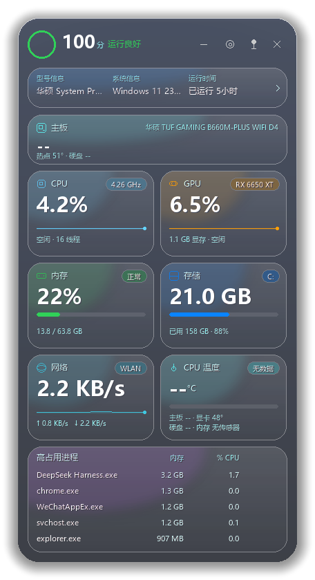

## 液态玻璃硬件监控 v1.1.3

Windows 系统托盘硬件监控面板，iOS 26 液态玻璃风格。**开箱即用，无需安装 Python。**



---

### 本次更新

**体积收敛完成：32.4MB → 17.47MB**，功能完全一致，且 CI 与本地构建现在完全对齐。

降体积经过三轮排查，前两轮都没找对地方：

| 版本 | 体积 | 判断 |
| --- | --- | --- |
| v1.1.0 | 32.40 MB | — |
| v1.1.1 | 32.40 MB | ❌ 以为是打包配置重复收录，改了没效果 |
| v1.1.2 | 22.50 MB | 移除未使用的 `numpy` / `requests`，降了 10MB |
| **v1.1.3** | **17.47 MB** | 锁定 Pillow 版本，CI 与本地一致 |

**v1.1.2 做的事**：`requirements.txt` 列着 `numpy` 和 `requests`，代码从未导入，
CI 按清单安装后 PyInstaller 把整个 numpy 运行时都打了进去。

**v1.1.3 做的事**：CI 装到的是最新 Pillow 12.3，比 11.2 多带若干编译插件。
锁定 `Pillow==11.2.1` 后，CI 产物与本地一致，又省 5MB。

比 v1.0.0 的 27.25MB 小将近 10MB。

**文档**

- [`VERSIONING.md`](https://github.com/fanggafa/hwmon-glass/blob/main/docs/VERSIONING.md)：语义化版本的升位判定标准
- [`CONTRIBUTING.md`](https://github.com/fanggafa/hwmon-glass/blob/main/docs/CONTRIBUTING.md) 增加「文档同步（强制）」
- 除 `README.md` 外，文档统一迁入 `docs/`，README 建立索引

---

### 功能一览

**监控**

| 项目 | 无需驱动 | 需要 PawnIO |
| --- | :---: | :---: |
| CPU 占用 / 频率 / 线程 | ✅ | |
| GPU 占用 / 显存 | ✅ | |
| 显卡温度 / 热点 | ✅ | |
| 硬盘温度 | ✅ | |
| 内存 / 磁盘 / 网络 | ✅ | |
| **CPU 温度** | | ✅ |
| **主板温度** | | ✅ |

**设置**（点齿轮图标或托盘右键菜单）

- 面板透明度 40%–100%
- 刷新间隔 0.5–5.0 秒
- 开机自动启动
- 配置保存到程序同目录的 `settings.json`

**托盘**

| 操作 | 效果 |
| --- | --- |
| 左键单击 | 显示/隐藏面板 |
| 右键 | 菜单：显示面板、图标指标切换、硬件详情、设置、退出 |

> Windows 11 默认把新图标折叠进「^」。把它拖到任务栏即可常驻。

---

### 下载

| 文件 | 说明 |
| --- | --- |
| `LiquidGlassMon.exe` | 单文件程序，17.47MB，双击运行 |
| `SHA256SUMS.txt` | 校验值 |

### 使用

1. 下载 `LiquidGlassMon.exe`
2. **双击运行** —— 首次启动会请求管理员授权
3. 若未安装温度驱动，程序会弹出引导窗口，点「立即安装」即可
4. 面板出现在屏幕右下角

> 单文件已包含 Python 运行时、全部依赖、传感器库、驱动安装包。
> 唯一的例外是内核驱动本身 —— Windows 要求它必须经 UAC 提权安装，
> 程序会自动引导你完成这一步。

### 已知限制

- **内存温度**需要内存条 SPD 传感器支持，多数消费级内存没有
- **显卡温度**依赖厂商驱动，虚拟机 / 远程桌面下可能读不到
- 天气功能尚未实现

### 校验

```powershell
Get-FileHash LiquidGlassMon.exe -Algorithm SHA256
```

---

**许可**：代码 MIT。内置的 [LibreHardwareMonitor](https://github.com/LibreHardwareMonitor/LibreHardwareMonitor) 为 MPL-2.0，[PawnIO](https://github.com/namazso/PawnIO) 为独立开源驱动。

**完整变更**：见 [CHANGELOG.md](https://github.com/fanggafa/hwmon-glass/blob/main/CHANGELOG.md)
